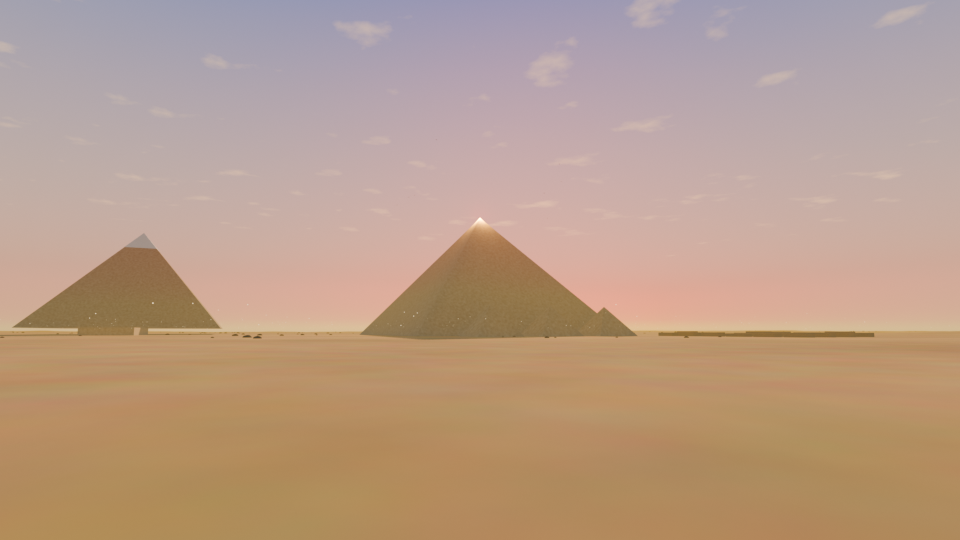
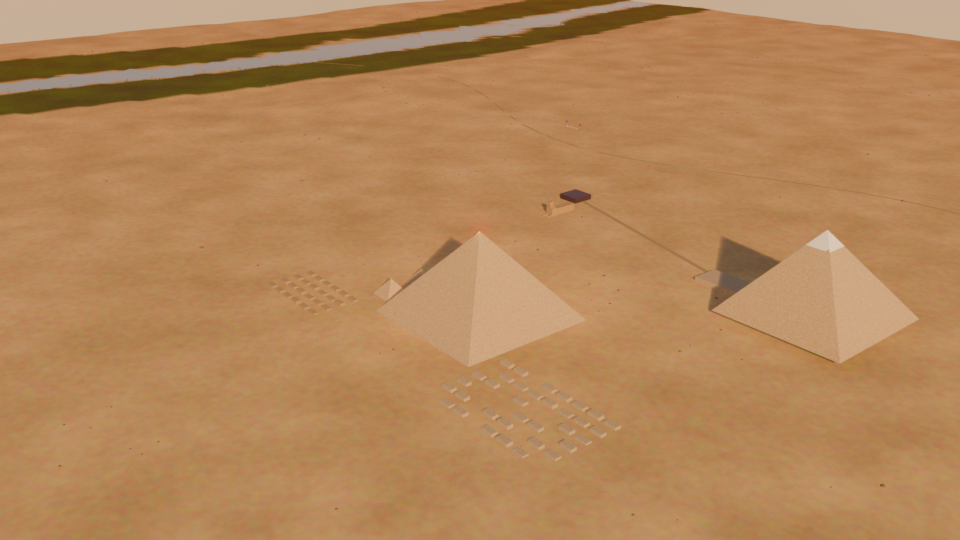
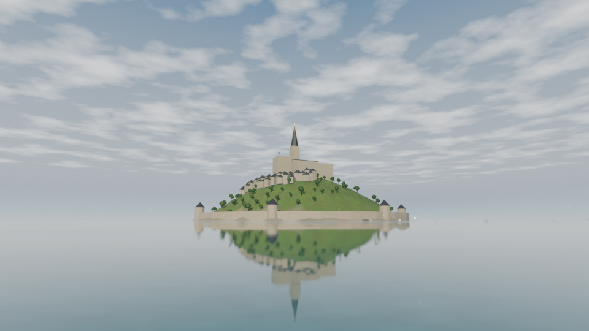
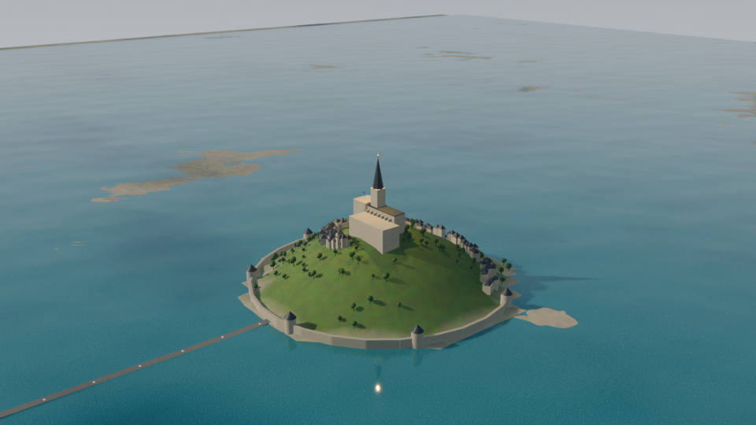
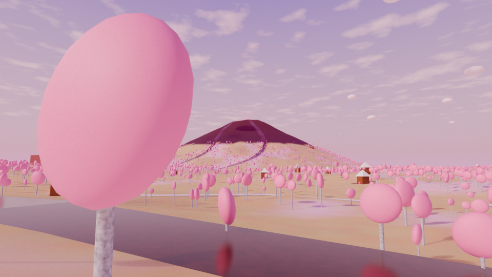
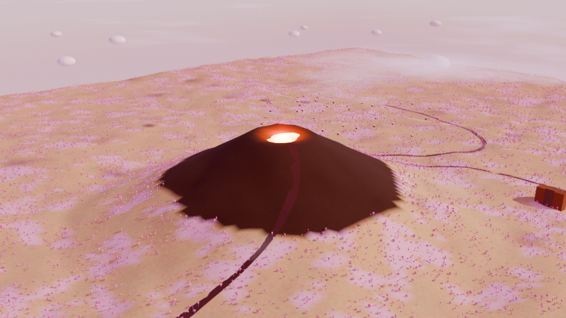
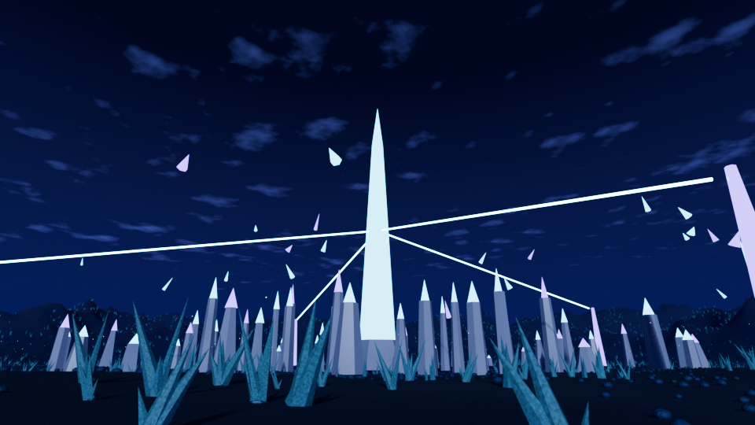
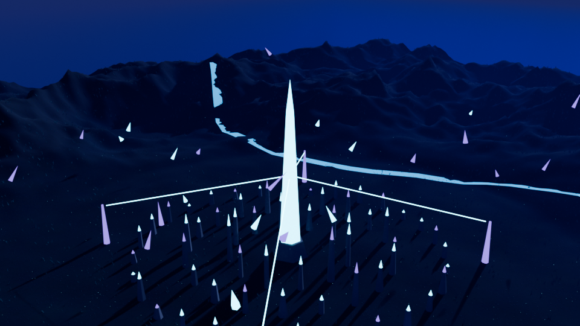
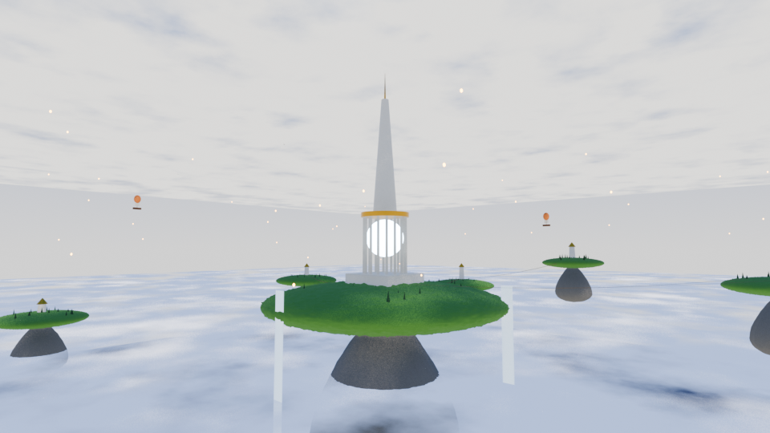
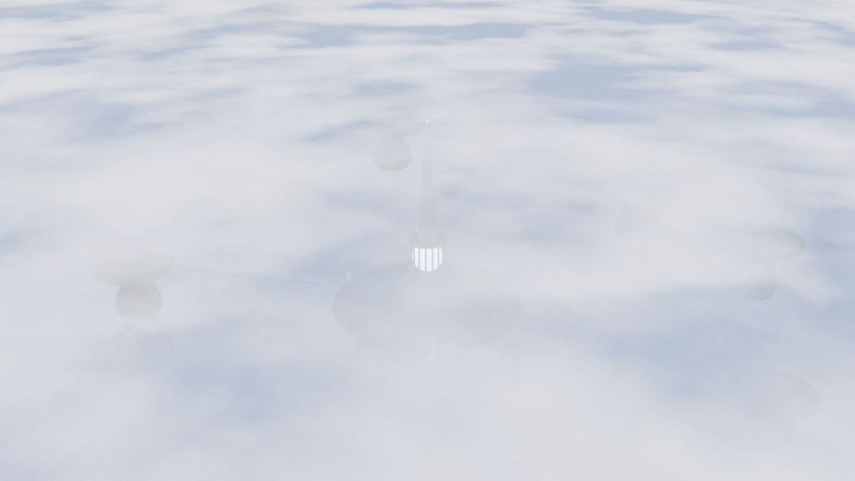

<p align="center"></p>

<h1 align="center">EpicWorlds50</h1>
<p align="center"><b>A Jaking Company environment-art production built entirely in Blender.</b><br>
50 open-world environments (25 real-world wonders, 25 original fantasy realms), each anchored by a 100 m+ Mega Landmark.</p>

<p align="center">


</p>

<p align="center">
<a href="https://jaking-studios.github.io/EpicWorlds50/"></a>
<a href="https://github.com/sponsors/jaineil32624"></a>
<a href="https://github.com/jaking-studios"></a>
</p>

---

## ▶ Play in your browser

**[jaking-studios.github.io/EpicWorlds50](https://jaking-studios.github.io/EpicWorlds50/)**: every world runs in the browser
(desktop and mobile) with a cinematic tour, free-orbit camera, live wind, birds, floating islands and clouds. Nothing to install.

## Download in one click

1. Click the green **Code** button, then **Download ZIP** (or grab the latest **Release**).
2. Unzip, open Blender 4.2 or newer (built on **5.2 LTS**), and open any file in `RealWorldLandmarks/` or `FantasyWorlds/`.
3. Press **Space** to play: wind, water, birds, clouds and lights animate immediately. Switch to **Rendered** view (Z → Rendered) to see fog and god rays.

No add-ons, no external textures, no missing files: every material is procedural and packed in the `.blend`.

## Milestone 1: 5 worlds shipped

| World | Mega Landmark | Height | Objects | Base verts | File | Preview render* |
|---|---|---|---|---|---|---|
| **Giza Plateau** | Great Pyramid of Khufu | 138 m | 207 | 51,093 | 2.11 MB | 21.55 s |
| **Mont-Saint-Michel** | Abbey spire & golden archangel | 177 m | 411 | 44,758 | 1.74 MB | 27.62 s |
| **Chocolate Land** | Cocoa Volcano | 420 m | 240 | 57,445 | 1.85 MB | 8.07 s |
| **Crystal Empire** | Prism Spire | 640 m | 244 | 42,673 | 1.63 MB | 30.6 s |
| **Sky Kingdom** | Storm Temple | 707 m | 435 | 12,981 | 0.59 MB | 11.84 s |

*EEVEE, 960×540, 64 samples, measured on the development PC (Windows, Blender 5.2 LTS). Vegetation instances are not
counted in "base verts": they are Geometry Nodes instances generated at render time.

## Render gallery

## Real-World Wonders

### Giza Plateau - The Great Pyramids





> Late afternoon on the Giza plateau: the three great pyramids rise over a sea of dunes, the Sphinx guards the causeway, and the Nile valley glows green on the eastern horizon.

- Interior: King's Chamber + Grand Gallery (CAM_Interior_KingsChamber)
- Real dimensions: Khufu 230.3 m base / 138.5 m, Khafre 215.3/136.4, Menkaure 104.6/65.5


`RealWorldLandmarks/RW01_GizaPlateau.blend`

### Mont-Saint-Michel - The Tidal Abbey





> A granite island crowned by a Gothic abbey rises out of the tidal flats of Normandy. Ramparts wrap a medieval village that spirals up to the church, and the spire's golden archangel can be seen from every corner of the bay.

- Interior: abbey nave with columns and candles (CAM_Interior_Nave)
- Rampart gap faces the causeway; 110 procedural village houses spiral the rock


`RealWorldLandmarks/RW02_MontSaintMichel.blend`


## Fantasy Mega Worlds

### Chocolate Land - Realm of the Cocoa Volcano





> Long ago a falling star of pure cocoa struck the Sugar Plains. Its crater became the Cocoa Volcano, which still pours molten chocolate rivers through wafer forests and gingerbread villages. Candy-cane pillars mark the old Sugar Road; hidden inside the volcano's flank is the Truffle Vault, where the first recipe is said to be kept.

- Secret: Truffle Vault hidden in the volcano's east flank
- 3 chocolate rivers + chocolate waterfall + pulsing caramel crater


`FantasyWorlds/FW01_ChocolateLand.blend`

### Crystal Empire - City of the Prism Spire





> The Crystal Empire grew from a single seed-shard that fell during the Night of Falling Light. Its people sing the crystals into shape: hexagonal towers ring the Prism Spire, whose heartbeat pulse powers the whole city. Shards torn loose by old storms still hover over the valley, and the Echo Caves beneath the northern ridge answer anyone who sings.

- Secret: Echo Caves under the north ridge
- Prism Spire heart pulses and powers 4 energy beams


`FantasyWorlds/FW02_CrystalEmpire.blend`

### Sky Kingdom - The Floating Continents





> When the old world sank beneath the Cloud Sea, its mountain-tops broke free and rose. The Sky Kingdom now drifts on those islands, linked by rope bridges and sky-ships. At its centre the Storm Temple holds a captive thunderstorm, and a sunken bell tower can still be glimpsed through gaps in the clouds far below.

- Islands float via drivers; bridges sag procedurally
- Captive storm with randomised lightning flashes
- Secret: sunken bell tower visible below the cloud sea


`FantasyWorlds/FW03_SkyKingdom.blend`


## What every world contains

| System | How it's built |
|---|---|
| **Procedural terrain** | Fractal + ridged noise heightfields, shaped per world (plateaus, volcanoes, tidal flats, basins) |
| **Texture painting** | Each terrain vertex is painted from slope + height into a `TerrainPaint` colour layer, plus float masks (`m_tree`, `m_grass`, `m_rock`...) |
| **Sculpting** | Rocks, cliffs, the Sphinx, marshmallow clouds and floating islands get stacked sculpt layers (subdivision + cloud and voronoi displacement) |
| **Geometry Nodes vegetation** | Mask-driven scatter of tree, grass, rock, candy and crystal assets with random yaw and scale |
| **LOD** | GN `Is Viewport` switch: the viewport shows 8–20% of the instances, renders get full density |
| **Wind** | Per-instance sway from GN Scene Time + world position, so no two trees move together |
| **Water** | Ocean modifier (animated), flowing-material rivers and waterfalls, chocolate and starlight rivers |
| **Atmosphere** | Gradient sky, bounded height-fog volume, volumetric sun shadows (god rays), drifting cloud layers |
| **Ambient life** | Bird and gull flocks with wing flaps, waving flags, floating dust/sparkle particles, flickering torches, pulsing crystals |
| **Day/night** | Set the scene property `day_night_speed` (e.g. `0.004`) and the sun sweeps across the sky |
| **Mega Landmark** | Enforced ≥100 m (the build fails otherwise) and topped by a pulsing beacon light |
| **Interiors / secrets** | King's Chamber + Grand Gallery (Giza), abbey nave (Mont-Saint-Michel), Truffle Vault, Echo Caves, sunken bell tower |
| **Cameras** | Hero Reveal (crane-up) → Drone Flythrough (orbit path) → Aerial, bound to timeline markers for a 60 s cut |
| **Asset library** | Source trees, rocks and every `EW_` material are marked as assets: open the Asset Browser to reuse them |

Every animation runs on drivers or Scene Time, so it loops forever and nothing needs baking.

## Trailers (60 s per world)

The camera cuts are already in every file. To render a trailer:

```bash
blender -b FantasyWorlds/FW01_ChocolateLand.blend -P Trailers/render_trailer.py            # final 1080p
blender -b FantasyWorlds/FW01_ChocolateLand.blend -P Trailers/render_trailer.py -- --preview  # fast draft
blender -b RealWorldLandmarks/RW01_GizaPlateau.blend -P Trailers/render_trailer.py -- --night # sunset pass
```

## Rebuild everything from source

The `.blend` files are generated, and the scripts are the real source:

```bash
blender -b -P SourceFiles/build_all.py               # rebuild all worlds
blender -b -P SourceFiles/build_all.py -- fw02       # just the Crystal Empire
blender -b -P SourceFiles/build_all.py -- --renders  # + preview stills
python Documentation/make_readme.py                  # refresh this README's stats
# web export: open a world in Blender, then run SourceFiles/web_export.py from the Text Editor
```

```
EpicWorlds50/
├── RealWorldLandmarks/   generated .blend files (RW##)
├── FantasyWorlds/        generated .blend files (FW##)
├── SourceFiles/
│   ├── pipeline/ew_core.py   shared world pipeline (terrain, GN scatter, water, FX, cameras)
│   ├── worlds/               one build script per world
│   └── build_all.py
├── Renders/              preview stills (hero + aerial per world)
├── Trailers/             render_trailer.py (+ your rendered .mp4s)
├── index.html, viewer.html   browser version (three.js), served by GitHub Pages
├── web/worlds/<ID>/      world.glb (Draco), instances.bin (GN vegetation), meta.json (sky, cameras, drivers)
├── Documentation/        per-world JSON stats, devlog, pipeline notes
├── Assets/branding/      Jaking Company logo
└── Animations/ Materials/ Textures/ Screenshots/   reserved for upcoming milestones
```

## Optimization methods

- Vegetation as **instances**, never realized geometry; source assets live in an excluded `ASSETS_Source` collection
- **Viewport LOD** through GN density switching; terrain kept at 40–50k vertices
- Procedural materials only, so there are no texture files and the `.blend` files stay at about 2 MB each
- Animated **drivers** instead of keyframes or simulations, so no cache files are needed
- Fog limited to a bounded volume (EEVEE treats World volumes as infinite, which costs performance and hides the sky)

## GitHub category

**Primary: Art & Design.** The deliverable is environment art (composition, lighting, materials, cinematic
presentation), and the code exists to produce images and scenes, not to be played or simulated.

**Secondary: Architecture.** Half of the worlds are architectural recreations built to real dimensions
(Khufu 230.3 m base / 138.5 m, Khafre, Menkaure, Mont-Saint-Michel's abbey).

**Also relevant: Virtual Experiences.** Every world is explorable, has interiors and hidden secrets, and ships with
cinematic camera paths.

**Not chosen:** Gaming (no gameplay loop), Simulation (motion is art-directed, not physically simulated), and
Education (historical accuracy is a goal but not the purpose).

Suggested repository topics: `blender` `environment-art` `geometry-nodes` `procedural-generation` `3d-art` `worldbuilding`

## Roadmap to 50

**Real-World Wonders (2/25):** next up: Great Wall of China, Taj Mahal, Red Fort, Mysore Palace, Windsor Castle, Tower of London, Buckingham Palace, Edinburgh Castle, Colosseum, Acropolis, Machu Picchu, Petra, Angkor Wat, Neuschwanstein Castle, Versailles, Forbidden City, Kyoto Imperial Palace, Himeji Castle, Brandenburg Gate, St. Basil's Cathedral, Alhambra, Castle Howard, Colonial Empire Port City.

**Fantasy Worlds (3/25):** next up: Wonder Land, Cookie Kingdom, Dragon Realm, Mechanical World, Moon Civilization, Underwater Kingdom, Cosmic Realm, Mushroom Hollow, Frost Giant Fjords, Clockwork Desert, Lantern Archipelago, Thunder Steppes, Coral Sky Reef, Obsidian Necropolis, Bamboo Cloud Temples, Glass Desert, Titan's Garden, Aurora Tundra, Bioluminescent Jungle, Sunken Library, Volcanic Forge City, Cosmic Observatory.

Each new world is one script in `SourceFiles/worlds/` built on the shared pipeline. Planned pipeline upgrades:
Cycles texture baking for real-time export, a central asset-library `.blend`, real-time exports (glTF), and HDRI lighting presets.

## Support the project

EpicWorlds50 is free to download. Building and rendering 50 worlds takes a lot of GPU hours, so if you enjoy it,
consider **[sponsoring on GitHub](https://github.com/sponsors/jaineil32624)**. Sponsors help fund the next batches
of worlds and the 1080p trailer renders, and every sponsor gets a thank-you in the credits of the next milestone.

Want a custom world or landmark built for your project? Open a request on
[JaKing's profile](https://github.com/jaineil32624/jaineil32624/issues/new?template=game-request.yml).

## Credits

- Concept, art direction and production: **Jaineil Rana (JaKing), Jaking Company**
- Built with Blender (GPL) using only built-in nodes, modifiers and Python. No third-party assets.
- Real-world landmark dimensions are drawn from public archaeological references. The recreations are stylized and not survey-accurate.

See [`Documentation/DEVLOG.md`](Documentation/DEVLOG.md) for the development diary.

<p align="center"><sub>© Jaking Company. EpicWorlds50.</sub></p>
